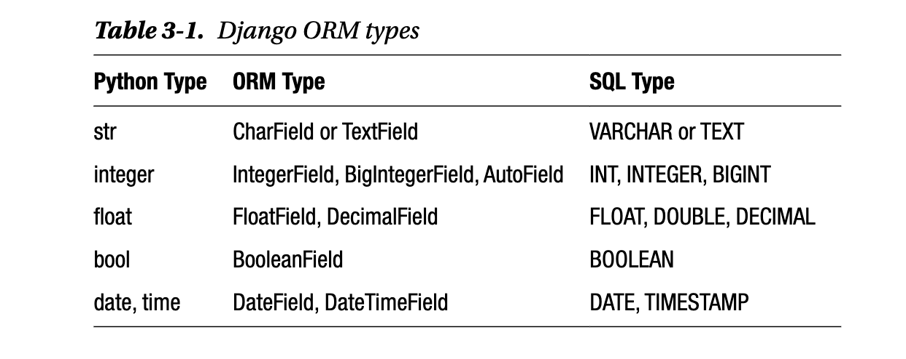
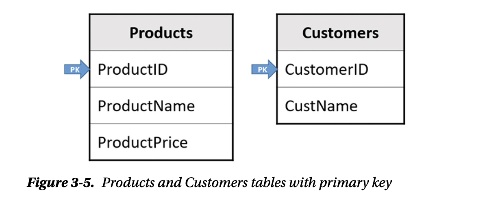
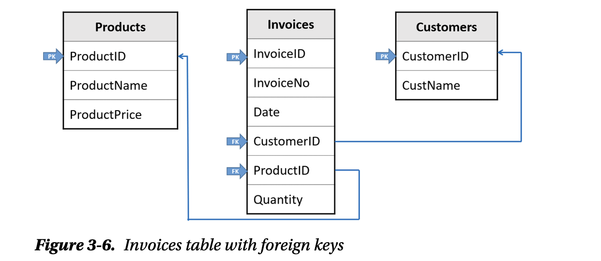

# Chapter 03 - Django ORM

Large, complex, and dynamic web-based applications are always data driven. The application invariably uses a certain database backend for data storage and retrieval. 

Instead of interacting with the database with raw SQL queries, Django recommends handling the database through an abstraction layer having Python objects callec **models**. 

**Objectives**

- [x] DB-API
- [ ] ORM
- [ ] Database configuration
- [ ] Model class
- [ ] Migrations
- [ ] Django admin shell
- [ ] CRUD operations
- [ ] Model field types
- [ ] Model relationships

## DB-API

The Python Database API (DB-API) is a collection of specifications recommended to be implemented by the database access modules for any relational database.

- Python modules acting as interface for respecrive relational databases - such as `mysqldb` or `mysqlclient` for MySQL, `psycopg` for PostgreSQL - use the same set of classes, objects, and functions as defined in the DB-API.

**SQLite** - it is a lightweight, file-based, serverless database.

- Python's standard library readily provides built-in support for working with SQLite in the form of sqlite3 module.
- to interact with a database, the first step is to establish a connection and obtain a connection object.

```python
import sqlite3
conn=sqlite3.connect("mydata.sqlite3")
```

- then we obtain a cursor object that acts as a handle to the database. this cursor object is responsible for executing all the SQL queries that perform `CREATE`, `RETRIEVE`, `UPDATE`, and `DELETE` operations which are known as **CRUD operations**.

```python
cur = conn.cursor()
```

- now we can call the `execute()` method of the cursor object and pass a string representing a valid SQL query to it.

Example: Create a Books table with field structure in the `mydata.sqlite3` database

```python
import sqlite3

conn = sqlite3.connect("mydata.sqlite3")
cur = conn.cursor()

qry='''
CREATE TABLE IF NOT EXISTS Books (
    id INTEGER (10) PRIMARY KEY,
    title STRING (50),
    author STRING (20),
    price INTEGER (10),
    publisher STRING (20)
    );
'''

cur.execute(qry)
conn.close()
```

The database can be accessed in a Django view function. How?? We pass a `SELECT` query to the execute() method of the cursor object from the sqlite3 module.

We can also use another view function to fetch a specific record whosw `id` is captured from the URL route as a path parameter.

- the `book()` view function takes two arguments; first one being the request object and the second one is id, which Django provides by parsing the mapped URL route.
- the SQL query is prepared statement that substitutes the value of id receieved from the URL dispatcher in the `SELECT` statement.

    - NOTE: the record returned by the `fetchone()` method of the cursor is rendered as the responnse.

**Limitations of DB-API**

1. Need for proficient skills in SQL syntax
2. Programming paradigm mismatch between Python and SQL.

## Object-Relational Mapper (ORM)

ORM API maps the object attributes with the structure of a table in a relational database. 

- a table is called a relation.
- each object corresponds to a row in the mapped table.
- each attribute of the object corresponds to a column in the table.


To add a database support to our Django application, we need to:

**Define a Model**

Here, we define a class with its attributes matching with the desired structure of a table in the relational database.

- this type of class is called a model and it subclasses the Model class defined in the `django.db.models` module.

NOTE: `Meta` subclass adds metadata of the model.

**Database configuration**

This step is for configuring the type of database we want to use. We can do so in the `settings.py` file under the `DATABASES` section. 

**Run migrations**

Migrations are for applying the changes we make to our database i.e., propagating the models into the database schema.

- `makemigrations` - helps Django detect if there have been new models added, or any existing models modified.

## Django Admin Shell

Command:

```text
python manage.py shell
```

To add objects:

- use `create()` method which is available to the **QuerySet class**. 

To retrieve objects:

- the Django model class has a `Manager` attribute. Django adds a Manager with the same objects to every model class.
- the `all()` method of the Manager class returns the QuerySet consisting of all the objects in the model.
- `get()` method allows us to fetch a single object (corresponding to a single row in the mapped table).

NOTE: `__str__()` method returns a string version of an object.

To search for objects;

- `filter()` method of the QuerySet corresponds to the SQL query `SELECT FROM` with the `WHERE` clause.

We can also apply Field lookup operators as the parameters in the `filter()` method:

1. contains - equivalent to `LIKE` in SQL
2. range - equivalent to `BETWEEN` in SQL
3. gte (greater than or equal to) - equivalent to `>=` in SQL
4. lte (less than or equal to) - equivalent to `<=` in SQL

**Updating the Objects**

Django ORM makes modifying one or more attributes of one or more objects in a model super easy. 

- the object Manager provides an `update()` method which accepts a variable number of keyword arguments, each specifying the new value of an attribute. 
    - under the hood, the `update()` method executes the SQL `UPDATE` query. 

```python
Book.objects.all().update(publisher="Springer")
```

- SQL `UPDATE` query:

```sql
UPDATE Books SET publisher="Springer"
```

We can also increase the price. We import the `F()` function from `django.db.models` module.

- it represents the value of a given model field. `F('price')` gives the value of the price field.

```python
from django.db.models import F
Book.objects.all().update(price=F('price')+100)
```

> When modifying the data in the database via Python objects always have to include the `filter()` method so that only select attributes are modified.


## Model Field Types

While a Django model is a regular Python class, the behaviour of its attributes is very unique. It subclasses the Model class in the `django.db.models` module.

- NB: the fields are the most crucial part of the model definition.

An **attribute** in a model class is a class attribute (an attribute outside any of the instance methods) and is an instance of an appropriate Field class. 

- for example: the attribute title, price, etc., are the instances of `CharField` and `IntegerField`.

When we declare an instance of a model, Django stores the data in an internal structure of its own and only maps this structure with the field structure whenever we call the API methods such as `create()`, `save()`, `update()`, or `delete()`.

1. **CharField**

- used to store string attributes such as name, title, etc
- for fairly large sized text, we can the `TextField` type.
    - additional argument: `max_length`

```python
title = models.CharField(max_length=50)
```

- NB: while the value in the given `CharField` is a Python string, when migrated to the database, the corresponding field becomes a `VARCHAR` or equivalent data type supported by the corresponding database product.

> the `TextField` attribute is mapped to SQL's `TEXT` field type.

2. **IntegerField**

- the attributes intended to store integer values such as EmployeeID, RollNo, etc., are defined to the of `IntegerField` type in a model.
- `BigIntegerField` (64-bit integer), `SmallIntegerField`, `AutoField`, etc are the other field types in the category. 
- we can set a certain field to be a primary key in a mapped table using a `primary_key` argument set to `True`.

```python
id = models.IntegerField(primary_key=True)
```

> the `IntegerField` is translated as `INT`, `INTEGER`.

3. **FloatField**

- a float Python object, which is an floating-point number, can be stored in an attribute of `FloatField` e.g., salary, price, etc

```python
salary = models.FloatField()
```

> a `FloatField` is conveniently mapped to `FLOAT` or `DOUBLE` field types in SQL.

3. **BooleanField**

- used to store bool types values (true or false). 

```python
isebook = models.BooleanField()
```

> most of RDMS products have a BOOLEAN field type, to which the `BooleanField` model attribute is mapped against.

4. **DateField**

- Python stores the date in the `datetime.date` object. the corresponding model attribute in Django is `DateField()`. 
- this attribute type is often required in a model definition e.g., date of birth, date of appointment, date of publication, etc. 

```python
publication_date = models.DateField()
```

> this type of model attribute is translated to the `DATE` type of SQL, when migrated.



## Types of Relationships

In a relational database, a relation is a table that represents an entity. The attributes of the entity are the columns in the table, and each row is an instance of the entity. 

One of the columns in a table is constrained to have a unique value and that's the primary key of the table.



When the primary key of one table appears as one of the fields in another table (which may have its own primary key) that is called the **foreign key**.

Example:



- in the figure above, we can see that the Invoices table has CustomerID field (or column) which refers to the CustomerID of the Customers table [foreign key]
- also, the ProductID column in the Invoices table is another foreign key as it refers to the primary key of Products table.

**Types of relationships**:

1. One-to-One Relationship

- a connection between two data tables or entities where a single record in the first table matches only one record in the second table, and vice versa.
- for example: college model and a principal model. 
    - a college can have only one principal, and one person can be a principal of only one college.

- translated into code, the College model can be described as follows:

```python
class College(Model):
    CollegeID = models.IntegerField(primary_key=True)
    name = models.CharField(max_length=50)
    strength = models.IntegerField()
    city = models.CharField(max_length=50)
```

- now when we define the Principal model, we have to provide the CollegeID field as the foreign key to indicate the person with the given ID is the principal of which college.
    - NB: the foreign key field must be of a special field type `OneToOneField`
    - the first parameter should be the table to which the foreign key refers to, and the second one specified what happends when the associated object in the primary model is deleted.
    - the `on_delete` option should be one of the following values:
        - CASCADE: deletes the object containing the FK
        - PROTECT: prevents deletion of the referenced object
        - RESTRICT: prevents deletion of the referenced object by raising RestrictedError

- translated into code, the Principal model with field structure:

```python
class Principal(models.Model):
    id = models.IntegerField(primary_key=True)
    name = models.CharField(max_length=50)
    qualification = models.CharField(max_length=50)

    CollegeID = models.OneToOneField(
        College,
        on_delete=models.CASCADE
    )
```

2. One-to-Many Relationship

- in a one-to-many relationship, one object of a model can be associated with one or more objects of another e.g., a teacher qualified to teach a subject and more than one teacher in a college who can teach the same subject.

- translating into code, the Subject model code:

```python
class Subjet(models.Mode):
    Subjectcode = models.IntegerField(primary_key=True)
    name = models.CharField(max_length=30)
    credits = models.IntegerField()
```

- the Teacher model has its own primary key. its foreign key Subjectcode establishes one-to-many relationship with the Subject model.

- translating into code, the Teacher model code:

```python
class Teacher(models.Model):
    TeacherID = models.IntegerField(primary_key=True)
    name = models.CharField(max_length=50)
    qualification = models.CharField(max_length=50)

    subjectcode=models.ForeignKey(
        Subject,
        on_delete=models.CASCADE
    )
```

3. Many-to-Many Relationship

- in a many-to-many relationship, multiple objects of one model can be associated with multiple objects of another model.
- Example: let's assume that the college has more than one teacher who can teach the same subject, additionally, a teach can teach more than one subject as well [many-to-many relationship].
- can be implemented with `ManyToManyField` type

```python
class Teacher(models.Model):
    TeacherID = models.IntegerField(primary_key=True)
    name = models.EmailField(max_length=50)
    qualification = models.CharField(max_length=50)
```

```python
class Subject(models.Mode):
    Subjectcode = models.IntegerField(primary_key=True)
    name = models.CharField(max_length=30)
    credits = models.IntegerField()
    teacher = models.ManyToManyField(Teacher)
```

>NOTE: A Many-to-Many relationship cannot be represented by simply putting one foreign key in either table because let's take for instance one subject can have multiple teachers and one teacher can teach multiple subjects. So how does Django implement this relationship???

> Django create a third table called an intermediary table, also known as a junction table or joing table.