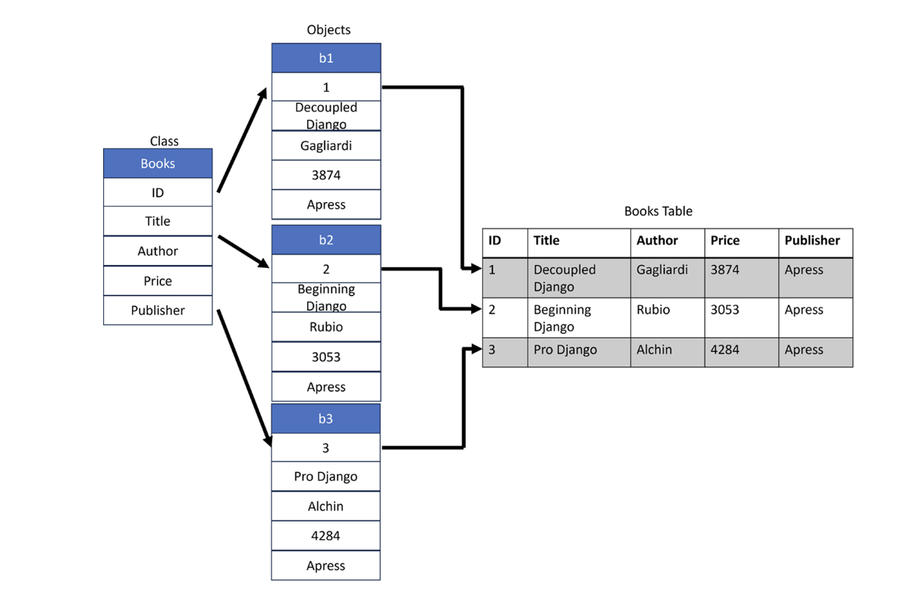

# Chapter 03 - Django ORM

Large, complex, and dynamic web-based applications are always data driven. The application invariably uses a certain database backend for data storage and retrieval. 

Instead of interacting with the database with raw SQL queries, Django recommends handling the database through an abstraction layer having Python objects callec **models**. 

**Objectives**

- [x] DB-API
- [ ] ORM
- [ ] Database configuration
- [ ] Model class
- [ ] Migrations
- [ ] Django admin shell
- [ ] CRUD operations
- [ ] Model field types
- [ ] Model relationships

## DB-API

The Python Database API (DB-API) is a collection of specifications recommended to be implemented by the database access modules for any relational database.

- Python modules acting as interface for respecrive relational databases - such as `mysqldb` or `mysqlclient` for MySQL, `psycopg` for PostgreSQL - use the same set of classes, objects, and functions as defined in the DB-API.

**SQLite** - it is a lightweight, file-based, serverless database.

- Python's standard library readily provides built-in support for working with SQLite in the form of sqlite3 module.
- to interact with a database, the first step is to establish a connection and obtain a connection object.

```python
import sqlite3
conn=sqlite3.connect("mydata.sqlite3")
```

- then we obtain a cursor object that acts as a handle to the database. this cursor object is responsible for executing all the SQL queries that perform `CREATE`, `RETRIEVE`, `UPDATE`, and `DELETE` operations which are known as **CRUD operations**.

```python
cur = conn.cursor()
```

- now we can call the `execute()` method of the cursor object and pass a string representing a valid SQL query to it.

Example: Create a Books table with field structure in the `mydata.sqlite3` database

```python
import sqlite3

conn = sqlite3.connect("mydata.sqlite3")
cur = conn.cursor()

qry='''
CREATE TABLE IF NOT EXISTS Books (
    id INTEGER (10) PRIMARY KEY,
    title STRING (50),
    author STRING (20),
    price INTEGER (10),
    publisher STRING (20)
    );
'''

cur.execute(qry)
conn.close()
```

The database can be accessed in a Django view function. How?? We pass a `SELECT` query to the execute() method of the cursor object from the sqlite3 module.

We can also use another view function to fetch a specific record whosw `id` is captured from the URL route as a path parameter.

- the `book()` view function takes two arguments; first one being the request object and the second one is id, which Django provides by parsing the mapped URL route.
- the SQL query is prepared statement that substitutes the value of id receieved from the URL dispatcher in the `SELECT` statement.

    - NOTE: the record returned by the `fetchone()` method of the cursor is rendered as the responnse.

**Limitations of DB-API**

1. Need for proficient skills in SQL syntax
2. Programming paradigm mismatch between Python and SQL.

## Object-Relational Mapper (ORM)

ORM API maps the object attributes with the structure of a table in a relational database. 

- a table is called a relation.
- each object corresponds to a row in the mapped table.
- each attribute of the object corresponds to a column in the table.



To add a database support to our Django application, we need to:

**Define a Model**

Here, we define a class with its attributes matching with the desired structure of a table in the relational database.

- this type of class is called a model and it subclasses the Model class defined in the `django.db.models` module.

NOTE: `Meta` subclass adds metadata of the model.

**Database configuration**

This step is for configuring the type of database we want to use. We can do so in the `settings.py` file under the `DATABASES` section. 

**Run migrations**

Migrations are for applying the changes we make to our database i.e., propagating the models into the database schema.

- `makemigrations` - helps Django detect if there have been new models added, or any existing models modified.

## Django Admin Shell

Command:

```text
python manage.py shell
```

To add objects:

- use `create()` method which is available to the **QuerySet class**. 

To retrieve objects:

- the Django model class has a `Manager` attribute. Django adds a Manager with the same objects to every model class.
- the `all()` method of the Manager class returns the QuerySet consisting of all the objects in the model.
- `get()` method allows us to fetch a single object (corresponding to a single row in the mapped table).

NOTE: `__str__()` method returns a string version of an object.

To search for objects;

- `filter()` method of the QuerySet corresponds to the SQL query `SELECT FROM` with the `WHERE` clause.

We can also apply Field lookup operators as the parameters in the `filter()` method:

1. contains - equivalent to `LIKE` in SQL
2. range - equivalent to `BETWEEN` in SQL
3. gte (greater than or equal to) - equivalent to `>=` in SQL
4. lte (less than or equal to) - equivalent to `<=` in SQL

**Updating the Objects**

Django ORM
