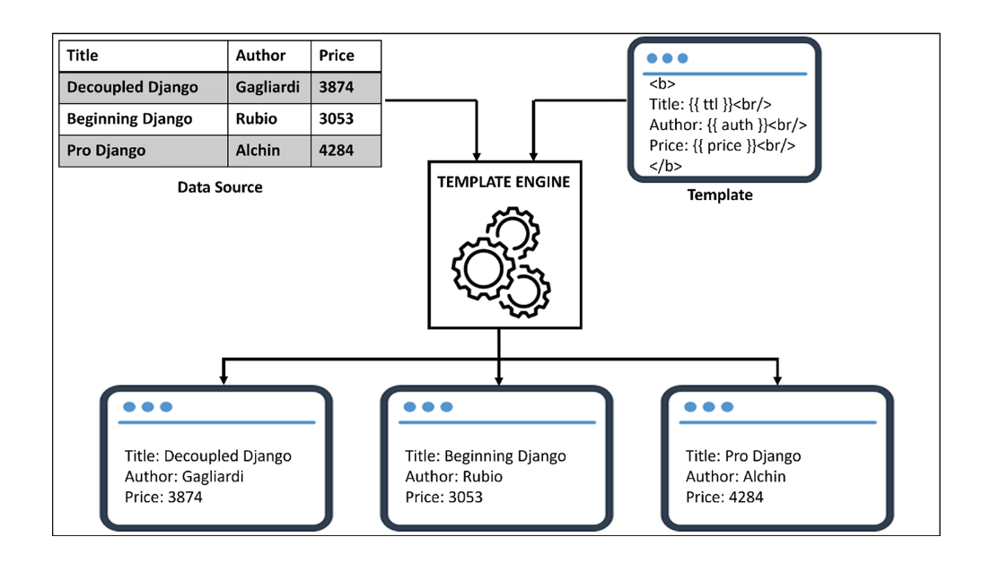

# Chapter 04 - Django Templates

Templates are the presentation layer of a Django web app. Since Django is a data-driven web framework, its elaborate template mechanism makes it very easy to merge the data from sources such as databases with the static HTML to generate dynamic web pages.

**Topics**

- [ ] Template object
- [ ] `render()` function
- [ ] Template context
- [ ] Template variables
- [ ] Tags
- [ ] Form templates
- [ ] Class-based views
- [ ] Generic views
- [ ] Static views
- [ ] Template inheritance

## Template Object

In the context of a web framework such as Django, a template is essentially a web page, with its static HTML content intermittently populated with template markups.

- Django uses Django Template Language (DTL) for this which essentially defines a set of symbols and keywords that are used in a template web page.
- the template engine then reads the template code, interprets the tags in it, and replaces them with the corresponding data from the context provided.

The templating mechanism is controlled by certain params set in the `settings` module (`settings.py`). 

- the TEMPLATES section sets the choice of template backend, the location of templates, etc.